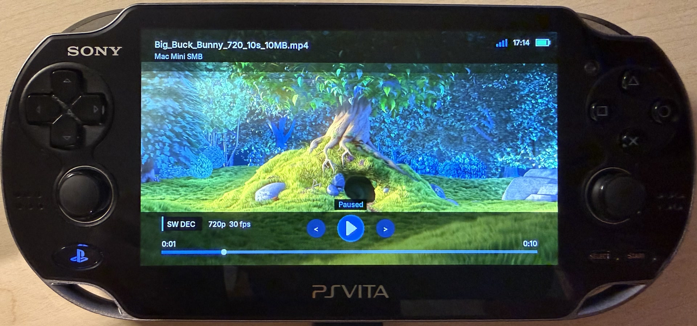

# vita-sw-decoder

Plug-and-play CPU H.264 player backend with optional AAC audio for PlayStation Vita. Video uses
FFmpeg's software H.264 decoder with Vita-tuned pthread workers; AAC output uses
the public Vita audio decoder. It never loads ReAvPlayer and never selects
`h264_vita`.

<p align="center">
  
</p>
<p align="center"><sub>FFmpeg software H.264 playback on PlayStation Vita</sub></p>

## Integrate in three steps

```sh
export VITASDK=/path/to/vitasdk
./tools/build-ffmpeg.sh
```

```cmake
set(VITA_SW_DECODER_FFMPEG_ROOT "/path/to/vita-sw-decoder/build/deps/ffmpeg-vita-sw")
add_subdirectory(external/vita-sw-decoder)
target_link_libraries(my_app PRIVATE VitaSwDecoder::VitaSwDecoder)
```

```c
#include <vita_sw_decoder.h>

VitaSwDecoderStreamFactory source;
vita_sw_decoder_file_stream_factory("ux0:video/movie.mp4", &source);
VitaSwDecoderPlayerConfig config = { .stream = source, .volume_percent = 100 };
VitaSwDecoderPlayer *player = vita_sw_decoder_create();
int result = vita_sw_decoder_open(player, &config);
```

The complete render loop is in `examples/local_file.c`.

## Current playback contract

- H.264 is decoded by FFmpeg on the CPU with Vita-tuned pthread workers; this
  package never loads or selects `h264_vita`.
- MOV/MP4 and Matroska sources may contain optional AAC audio. The initial
  zero-based audio ordinal comes from `VitaSwDecoderPlayerConfig.audio_track`.
- `vita_sw_decoder_select_audio_track()` restarts only the audio cursor at a
  supplied media timestamp, retaining the live video pipeline, pause, and
  volume state.
- `start_position_ms`, seeking, stream-reported bitrate, duration, decoded/shown
  counters, and dropped-frame counters are exposed through the public config and
  status structures. Runtime seeks reuse the open demuxers, flush to the target
  keyframe, and rebuild only the decode pipelines; a full reopen remains the
  recovery fallback. Audio is released after the first decoded video frame,
  with seek preroll capped at 600 ms rather than waiting for a multi-frame
  startup cushion.
- Stream discovery runs within the configured probe/analyse bounds whenever
  the required H.264/AAC parameters are incomplete, including for indexed MP4
  and Matroska inputs; complete indexed inputs keep the fast path. If an initial
  saved-position seek fails or
  points at/past the reported end, playback performs a checked restart at zero
  rather than decoding linearly through a long file.
- A stream factory can represent a Vita file or an authenticated remote reader,
  but every `open()` call must return a fresh readable, seekable cursor.

VitaMediaDeck layers track metadata, embedded text-subtitle demux, cover/frame
previews, resume history, and player UI above this package. Those policies are
intentionally not part of the standalone decoder API.

## Use both backends in one app

`vita-sw-decoder` and `vita-hw-decoder` use the same lifecycle and stream
contract but have distinct symbols and CMake targets, so they can be linked
together. An application can try the hardware package first, destroy that
session on failure, then reopen the same stream factory with
`vita_sw_decoder_open()`. `vita_sw_decoder_backend_name()` returns `software`.
`VitaSwDecoderPlayerStatus.video_bitrate_bps` exposes the H.264 stream bitrate
reported by FFmpeg, with the container bitrate used only when the stream does
not provide one. A zero value means the source did not advertise a bitrate.
`VitaSwDecoderPlayerConfig.audio_track` selects a zero-based AAC stream
ordinal, and `vita_sw_decoder_select_audio_track()` changes it at the supplied
playback timestamp without interrupting the video decoder or losing pause and
volume state.

The source factory creates two independent seekable cursors (audio and video).
It therefore works with local files and with remote Range readers. Supported
content is a seekable container recognized by the pinned FFmpeg build with
H.264 video with optional AAC audio in a MOV/MP4 or Matroska container. CPU decoding is deliberately a compatibility path;
resolution and frame-rate limits must be measured on hardware.

## Install and consume

```sh
cmake -S . -B build/package \
  -DVITA_SW_DECODER_FFMPEG_ROOT="$PWD/build/deps/ffmpeg-vita-sw"
cmake --build build/package
cmake --install build/package --prefix "$PWD/build/stage"
```

Installed consumers may use `find_package(VitaSwDecoder CONFIG REQUIRED)` and
link `VitaSwDecoder::VitaSwDecoder`. The installed package carries its pinned
FFmpeg static archives, license text and corresponding source.

## Related repositories

| Repository | Relationship |
| --- | --- |
| [`VitaMediaDeck`](https://github.com/spyro-98/VitaMediaDeck) | Main application and hardware-first/software-fallback orchestrator |
| [`vita-hw-decoder`](https://github.com/spyro-98/vita-hw-decoder) | API-compatible hardware H.264 backend |
| [`vita-https`](https://github.com/spyro-98/vita-https) | Hardened seekable HTTPS Range source used by WebDAV playback |
| [`VitaMediaDeck-Transcoder`](https://github.com/spyro-98/VitaMediaDeck-Transcoder) | Optional desktop producer of compatible H.264/AAC Matroska files |

Licensed GPL-3.0-only. See `THIRD_PARTY_NOTICES.md` for FFmpeg and VitaSDK
requirements.
